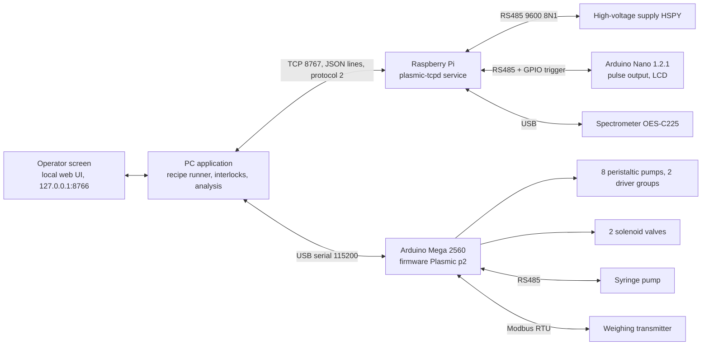

# Autonomous Laboratory for Automated Solution Preparation and Quantitative Analysis

[](https://github.com/liangyuchen-research/laboratory-instrument-control/actions/workflows/checks.yml)

Control software for a plasma-spectroscopy measurement station, developed at the Plasma Engineering Laboratory, National Taiwan University. **Plasmic EC 2.0.0** (this release) joins three pieces of hardware under one touch-screen operator interface: an Arduino Mega pump board for solution preparation, a Raspberry Pi that drives the high-voltage pulse source and the spectrometer, and the Windows PC that runs the operator screen, the recipe engine, the safety interlocks and the spectral analysis. Pumps, discharge and spectra are sequenced by a recipe; concentrations (Cu, Zn, Ni) come from calibrated emission-line intensities.

**Stack:** Python 3.12 (standard library only on the PC and the Pi), vanilla ES-module JavaScript with a strict CSP, Arduino C++ (Mega 2560 and Nano), newline-delimited JSON over TCP, RS485 / Modbus RTU, systemd, PowerShell and batch launchers.

## System overview



- **One measurement path.** The operator picks a flow (a published recipe, or a step list written on the schedule page), then starts a schedule. A round doses the solution, runs the discharge-and-capture job on the Pi, drains and cleans, and files the spectra, the derived concentrations and the round record.
- **Recipe language.** Recipes are CSV files with one step per row: pump a volume, pump two pumps at once (one per driver group), dose by weight, run the plasma, clean, wait, and syringe-pump operations. Every recipe is validated (ordering, liquids, limits, estimated time) before it can be published or started.
- **Pump board wrapper.** `pc/pumpboard.py` wraps the bit-for-bit copy of the earlier v7 pump backend (`pc/vendor/v7`): the Mega is found by USB identifier, only allow-listed commands are sent, timed runs are finite-step moves the board finishes on its own, and with the Plasmic firmware the board also performs gravimetric dosing, enforces a host watchdog and accepts the pump-to-liquid and valve-link assignment.
- **Discharge job.** `rpi/tcpd/plasma_measure.py` prepares the pulse controller, writes the set voltage to the supply over RS485 when it differs from the parameters, switches the supply on without pulses, takes one background spectrum, then for each cycle exposes the spectrometer and triggers the pulse train; the supply is switched off before the last spectra are collected. A protected fallback job (`rpi/rpi_tools/plasma_job.py`) is kept unchanged.
- **Safety.** Pumps may not start while the supply is on or its state is unknown; a flow that uses high voltage may not start while a pump is running; a background check stops the pumps if the supply comes on from outside the program. The on-screen **STOP** needs no PIN and always answers, reporting separately what the pump board and the Pi confirmed. Maintenance pages are behind a PBKDF2-hashed PIN. Automated tests never open a real serial port (`PLASMIC_NO_SERIAL` tripwire) and only ever connect to `127.0.0.1`.
- **Analysis.** Spectra are turned into line intensities and concentrations on the PC (`pc/analysis.py`, `pc/calibration.py`, `pc/analyst.py`), ported from the laboratory's earlier HMI; the calibration page runs a standards series as a schedule and fits the coefficients, the trend page plots concentrations over time with blank thresholds.

| Directory | Contents |
| --- | --- |
| `pc/` | PC application: `app.py` entry point, `application.py` + `httpd.py` (HTTP routes and `/api/state`), `recipe.py`, `steps.py`, `runner.py`, `schedule.py`, `manual.py`, `devices.py` (ownership and interlocks), `pumpboard.py`, `megasim.py`, `pump_guard.py`, `rpilink.py`, `plasmic_client.py`, `netcheck.py`, `store.py`, `migrate.py`, `pinlock.py`, `alarms.py`, analysis modules, `web/` (operator screen), `vendor/` (v7 pump backend, pyserial, PyYAML), `recipes/` (example CSVs) |
| `rpi/` | Raspberry Pi side: `tcpd/plasmic_tcpd.py` (TCP server, `--sim` simulator), `tcpd/plasma_measure.py` (discharge job), `rpi_tools/` (field-verified pulse and verification tools), `system/` (udev rules and systemd units), `install_rpi.sh` |
| `mega/` | Pump-board firmware **Plasmic p2**: `tools/make_firmware.py` generates `source/PlasmicMega/` from the v7 sketch, `build_firmware.py` compiles with a local Arduino IDE, `flash_mega.py` flashes and verifies (`--stock` returns to the v7 firmware), `hex/` holds both images, `backup/` the flash read out of the board before the first flashing and the earlier p1 build |
| `nano/` | Pulse-controller firmware 1.2.1 for the Arduino Nano (sources and hex) |
| `installer/` | `install.py` one-click installer (PC side, Pi side over ssh/scp, connection settings), `flash_nano.py`, PowerShell helpers |
| `tests/` | 23 test files, about 1,000 tests, run against simulated devices and the two simulators |
| `docs/` | Design record and documentation sources: `integration-design-2.0.0/design/` (SPEC, API contract, amendments M0–M23, work packages), `maps/` (code reading notes of the three source systems), the full user guide `detailed-guide.html` and its source files (`guide-source/`), check tools |
| `legacy/` | Earlier implementations kept as separate trees (see [Source versions](#source-versions)) |
| `*.cmd` | Double-click launchers for the laboratory PC: `Install.cmd`, `Start.cmd`, `Start-Demo.cmd`, `Start-Kiosk.cmd`, `Set-PIN.cmd`, `Flash-Nano.cmd` |

The operator screen, guides, design documents, code comments, and this README are written in English.

## Run locally (practice mode)

Practice mode starts the operator screen with a simulated pump board and a simulated Pi on the same machine; no hardware and no third-party package is needed. Python 3.12 or newer:

```bash
PLASMIC_NO_SERIAL=1 python pc/app.py --demo --no-browser --port 8794 --sim-port 8774 --data /tmp/plasmic-demo
```

Then open `http://127.0.0.1:8794/`. The maintenance PIN in practice mode is `000000`. Without `--no-browser` the program opens the screen itself; without `--port` it listens on 8766 and the Pi simulator on 8767. The screen is laid out for a 1024 × 768 touch panel and scales to wider windows; add `?fs=0` to the URL to skip the full-screen start layer.

On the laboratory PC the launchers use a bundled, embeddable Python 3.12 that is unpacked on first start (see [Third-party files](#third-party-files-not-in-this-repository)); `Start-Demo.cmd` is the same practice mode.

## Installation on the laboratory PC

1. Flash a new Arduino Nano with `Flash-Nano.cmd` (uses a bundled avrdude; the Nano must not be installed in the machine yet).
2. Connect the PC and the Pi with a network cable (the Pi is `192.168.1.1` by default). The installer keeps the Pi's address and login name in `installer/site.json`, which it writes itself and which is not committed; it never stores a password.
3. Run `Install.cmd`: it prepares the PC, installs `rpi/` on the Pi over ssh/scp (`plasmic-tcpd` systemd service, udev rules, drivers), writes the connection settings and tests the link. Updating to a newer version is the same step.
4. Set the maintenance PIN with `Set-PIN.cmd` (6–8 digits), then start with `Start.cmd` (or `Start-Kiosk.cmd` for a full-screen Edge kiosk on a touch panel).
5. Connect the Mega by USB. The program finds the only Arduino Mega on the machine by itself and reports which port it is; no port has to be chosen.

Each pump is shown as **Pump 1–8** in wiring order. What each pump carries (water, OUT drain, a named chemical, or nothing), which two pumps the automatic cleaning uses, and which valve follows which pump are set on the maintenance page *Pumps & scale*; the program sends the assignment to the board at every connection. Per-pump calibration (dose 10 mL, enter the measured volume) is on the same page.

The complete installation guide, wiring notes, the first-start checklist and the troubleshooting section are in `docs/detailed-guide.html`.

## Pump-board firmware

The Mega runs **Plasmic p2**, the v7 pump firmware plus four additions; every v7 command is unchanged, so the earlier v7 software still works with the same board.

| Addition | Commands |
| --- | --- |
| Gravimetric dosing performed on the board (target reached, timeout, mass no longer rising or no scale reading all stop the pump without the PC) | `GP`, `GN`, `G`, `G,?` |
| Host watchdog that stops open-ended continuous runs when the PC goes quiet | `K,<ms>` (off at boot) |
| Cleaning pumps and valve links set by the PC (numbers only; the board returns to the v7 wiring at every reset) | `CM,<water>,<out>`, `VL,<8 valve ids>` |
| Status fields `fw=`, `wd=`, `dose=`, `clean=`, `links=` | `?` |

Command lines are at most 62 characters (the Mega's receive buffer is 63 bytes). The board was flashed on 2026-10-07 and verified byte-for-byte; the SHA-256 of `mega/hex/plasmic-mega.hex` is checked by `tests/test_megasim.py`, and `pc/megasim.py` is the model of this firmware used by practice mode and the tests.

## HTTP interface of the PC application

The operator screen talks to the local application only; the service is meant for a laboratory control PC and has no authentication for an internet-facing deployment. The full contract, including the complete shape of `/api/state`, is in `docs/integration-design-2.0.0/design/API.md`.

| Endpoint | Purpose |
| --- | --- |
| `GET /api/bootstrap`, `GET /api/state` | Static configuration and the complete live state (Pi status, pump board, interlocks, round progress, alarms) |
| `GET/POST /api/flow` | The step list of the schedule page (up to 60 steps, actions of `recipe.FLOW_ACTIONS`) |
| `POST /api/schedule/preview`, `/api/schedule/start`, `/api/pause`, `/api/resume` | Schedules: one or more rounds of a recipe, intervals, operator confirmation |
| `POST /api/stop` | Software stop for pumps and the Pi; never needs a PIN, always answers |
| `POST /api/manual` | Manual pump, dosing, cleaning and syringe operations with equipment ownership |
| `GET/POST /api/recipes…` | Recipe listing, validation, publishing, CSV download and deletion |
| `POST /api/parameters`, `/api/rpi/check`, `/api/rpi/tool` | Plasma parameters (written to the supply and the Nano), a fresh read-only check of the supply and the Nano, maintenance tools |
| `GET/POST /api/pump/setup`, `/api/pump/calibrate`, `/api/pump/config`, `/api/scale/tare`, `/api/scale/calibrate` | Pump assignment, per-pump calibration, board selection, scale tare and calibration |
| `POST /api/unlock`, `/api/lock` | Maintenance PIN session (10 minutes, rate-limited) |
| `GET /api/runs…`, `/api/rounds/<id>`, `/api/runlog`, `/api/events` | Stored spectra and CSV export, round records, run log, event log |

The Pi speaks a separate JSON-lines protocol (`hello`, `status`, `prepare`, `set_parameters`, `sync_voltage`, `spectrum`, `plasma_run`, `stop`, `job`, `result`, …) with a shared token and an address allow-list; `pc/plasmic_client.py` is a small command-line client for it, and `rpi/tcpd/config.example.json` the server configuration.

## Verification

```bash
export PLASMIC_NO_SERIAL=1
for t in recipe store rpilink analysis calibration measurements analyst pumpboard megasim pump_guard \
         port_safety interlock manual runner app api_pin flow web_static vendor tcpd; do
  python -B tests/test_$t.py
done
python -B tests/test_measure.py      # the discharge job on a simulated RS485 bus; timing-sensitive, run on its own
python -B docs/tools/check_sums.py   # the field-verified files listed in SHA256SUMS.txt are unchanged
```

The tests use simulated devices (`tests/simulated_rig.py`, `tests/simulated_spectrometer.py`), the pump-board model and the Pi simulator; they check the recipe language, data migration from 1.3.0/1.4.1, the interlocks and the stop paths, the pump-board wrapper and firmware model, the discharge job including its stop and switch-off paths, the HTTP contract, PIN handling, the static front end, the installer and the Nano flasher. `tests/test_flash_nano.py` and `tests/test_installer.py` also check that the bundled third-party binaries are present, so those few checks fail in a clean checkout, and several files expect the installer's `site.json` (not committed; the workflow writes one with the built-in defaults). `tests/test_app.py`, `tests/test_tcpd.py` and `tests/test_measure.py` rely on Windows socket semantics and millisecond timing and are run on the station. The workflow in `.github/workflows/checks.yml` runs the suite on Linux with Python 3.12, and those three files on a Windows runner for information.

**Hardware status (as of 2026-10-07).** Simulator results validate the software, not the equipment. On the real station this release has so far: connected to the Pi and auto-detected the pump board; migrated the station's data; started and stopped Pump 1–4 by hand (with firmware p1); read the supply, the Nano and the scale; captured one spectrum without a discharge; and had the p2 board accept the `CM`/`VL` assignment. Not yet exercised on hardware: the 2.0.0 discharge-and-capture flow, on-board gravimetric dosing, the watchdog, valve links, two-pump dosing, syringe steps, automatic cleaning, the interlocks under a live supply, calibration, and the touch layout on the panel. The last discharges on the station (30 V) were made on 2026-10-05 with the 1.2.0 program. The first-start checklist in `guide.html` is the planned hardware verification: observe only → pumps with water → discharge at 30 V with the load disconnected → load reconnected.

The on-screen stop is software, not an emergency stop. Isolate the high-voltage and the 24 V drive supplies with their physical switches before wiring or maintenance.

## Third-party files not in this repository

The laboratory folder carries a few third-party binaries that are not committed here. Their SHA-256 values are recorded in `SHA256SUMS.txt` and `nano/THIRD-PARTY-SOURCES.txt`, and `docs/tools/check_sums.py` verifies them.

| Path in the laboratory folder | What it is | Source |
| --- | --- | --- |
| `pc/runtime/python-3.12.10-embed-amd64.zip` | Embeddable Python used by the `*.cmd` launchers (unpacked to `pc/runtime/python/` on first start) | python.org Windows embeddable package 3.12.10 |
| `nano/tools/avrdude/avrdude.exe`, `avrdude.conf` | Flashing tool used by `Flash-Nano.cmd` | AVRDUDE 8.3, Windows x64 release (GPL-2.0-or-later) |
| `nano/drivers/CH341SER.EXE` | CH340/CH341 USB-serial driver installer for compatible Nanos | WCH (Nanjing Qinheng) driver download |
| `rpi/app/lib_linux_ARM_2.7.11.so` | Spectrometer vendor SDK (32-bit armhf) | Spectrometer vendor, as installed on the station |
| `rpi/drivers/uno220gpio_0.1-3_armhf.deb`, `uno220uart_0.1-3_armhf.deb` | Advantech UNO-220 GPIO and UART drivers | Advantech, as installed on the station |

`pc/vendor/` holds pure-Python copies of pyserial 3.5 (BSD-3-Clause) and PyYAML 6.0.2 (MIT) with their notices, the v7 pump backend and its `hardware.yaml`, and the Barlow fonts (SIL OFL 1.1) used by the screen. Nothing in `pc/vendor/` is edited; `docs/tools/check_v7_sync.py` compares it against `pc/vendor/MANIFEST.sha256`.

Runtime data (`pc/data/`, `pc/data-demo/`: connection settings and token, PIN hash, recipes, spectra, logs) is created by the program and is not part of the repository.

## Source versions

The root of this repository is **Plasmic EC 2.0.0** (PC program and Pi server 2.0.0, protocol 2, Nano firmware 1.2.1, Mega firmware Plasmic p2), the version in use on the station. It was built from three earlier systems, whose code-reading notes are in `docs/integration-design-2.0.0/maps/`:

- [`legacy/autonomous-laboratory-v6`](legacy/autonomous-laboratory-v6/README.md) — the previous root of this repository: the FastAPI pump-control service, the v6 Arduino Mega firmware and the wiring guides for the pump assembly. The same backend is vendored unchanged under `pc/vendor/v7`, and the Plasmic firmware is generated from its sketch.
- [`legacy/instrument-control`](legacy/instrument-control/README.md) — the earlier Raspberry Pi / STM32 pulse-control and spectrometer-acquisition system, kept with its Git history.
- The laboratory's earlier HMI (not published), whose page structure, visual style and spectral analysis the 2.0.0 operator screen reproduces.
